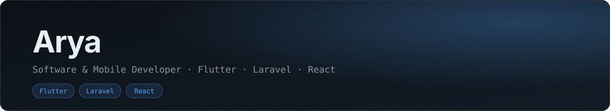

 

---

## `01` About Me

I'm Arya, a **Software and Game Development (PPLG)** student at SMK Raden Umar Said Kudus, Indonesia.

I enjoy building web and mobile applications, exploring new technologies, and turning ideas into working projects. Currently, I'm focusing on **Laravel, React, and Flutter** while improving my fundamentals through hands-on development.

- Currently learning **Flutter, Laravel, and React**
- Interested in **mobile app and UI/UX**
- Learning through experiments, side projects, and problem-solving
- Open to collaboration and opportunities to grow as a developer

## `02` Tech Stack

**Languages & Frameworks**

**Tools & Platforms**

## `03` Selected Projects

<table>
<tr>
<td width="50%" valign="top">

### [Project Laravel](https://github.com/raymndusArya/Project-Laravel)

Web development project built with Laravel and Blade.

`PHP` `Laravel` `Blade`

</td>
<td width="50%" valign="top">

### [Flutter Projects](https://github.com/raymndusArya/projectFlutter-1)

A hands-on project for learning Flutter and Dart application development.

`Flutter` `Dart`

</td>
</tr>
<tr>
<td width="50%" valign="top">

### [First React Project](https://github.com/raymndusArya/First-React-JS-Project)

My first step into building web interfaces with React and JavaScript.

`React` `JavaScript`

</td>
<td width="50%" valign="top">

### [API & RecyclerView](https://github.com/raymndusArya/API-Implementations-RecyclerView)

An Android project exploring API integration and displaying data using RecyclerView.

`Android` `API` `RecyclerView`

</td>
</tr>
</table>

## `04` GitHub Activity

 

## `05` Beyond the Code

When I'm not coding, I enjoy exploring **photography, visual design, and music**. I like learning how different creative disciplines approach problems and using those ideas in my own projects.

## `06` Find Me Elsewhere

---
